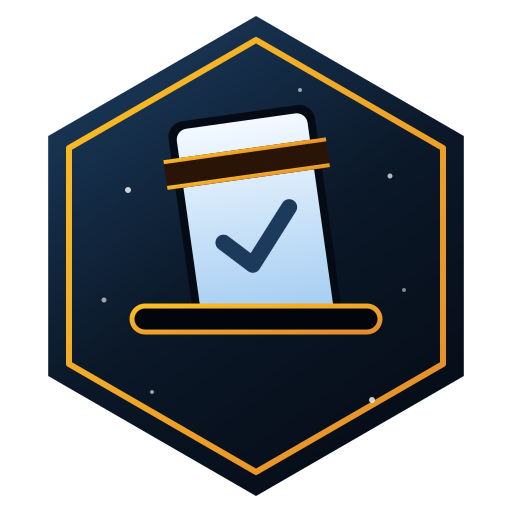
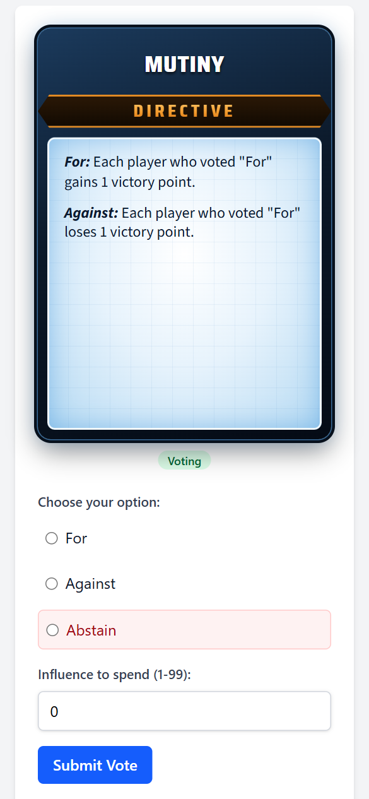
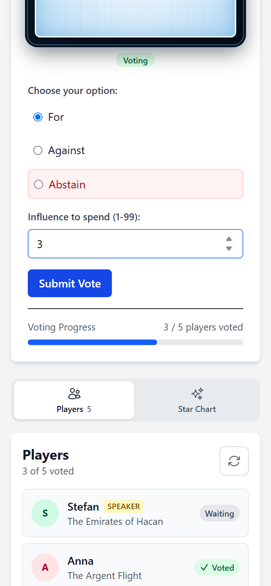
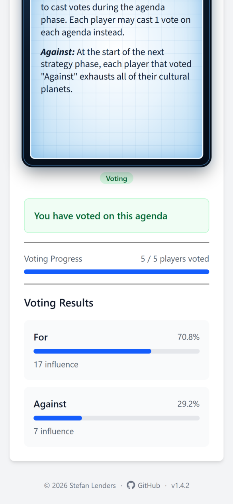
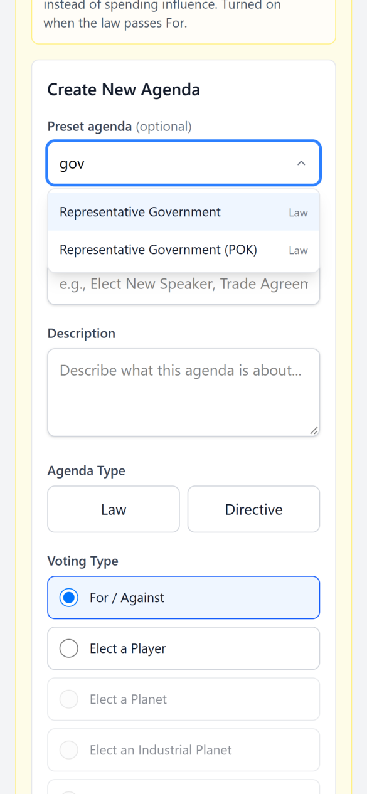
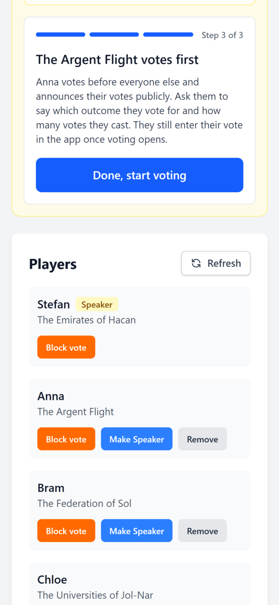
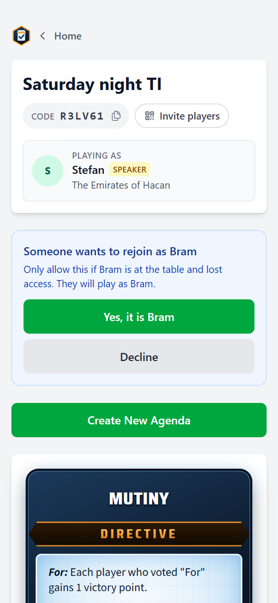

<p align="center">
  
</p>

# TI Voting
A secret voting system for **Twilight Imperium 4th Edition (TI4)** agenda phase sessions. Players vote anonymously while the speaker can see the final results. Influence tracking is built in, and it integrates with [Milty](https://milty.shenanigans.be/) to automatically load faction and planet data from your draft.
## Features
- **Anonymous voting** — players cannot see how others voted until results are revealed
- **Influence tracking** — tracks influence tokens spent per vote
- **Speaker controls** — only the speaker can create agendas and reveal results
- **Milty integration** — paste a Milty draft URL to auto-load faction and planet data for all players
- **Preset agendas** — choose from a library of TI4 agenda cards
- **Real-time updates** — votes and state changes sync instantly via WebSockets (Laravel Reverb)
- **No accounts required** — players join using a game code and a display name
## Screenshots
<table>
  <tr>
    <td align="center" width="33%">
      <picture>
        <source media="(prefers-color-scheme: dark)" srcset="docs/screenshots/08-player-agenda-card-dark.png">
        
      </picture>
      <br><sub>The revealed agenda as a digital card</sub>
    </td>
    <td align="center" width="33%">
      <picture>
        <source media="(prefers-color-scheme: dark)" srcset="docs/screenshots/09-player-vote-dark.png">
        
      </picture>
      <br><sub>Players vote in secret on their phone</sub>
    </td>
    <td align="center" width="33%">
      <picture>
        <source media="(prefers-color-scheme: dark)" srcset="docs/screenshots/10-speaker-results-dark.png">
        
      </picture>
      <br><sub>The Speaker sees the results</sub>
    </td>
  </tr>
  <tr>
    <td align="center" width="33%">
      <picture>
        <source media="(prefers-color-scheme: dark)" srcset="docs/screenshots/05-agenda-search-dark.png">
        
      </picture>
      <br><sub>Search the preset agendas</sub>
    </td>
    <td align="center" width="33%">
      <picture>
        <source media="(prefers-color-scheme: dark)" srcset="docs/screenshots/07-speaker-argent-flight-dark.png">
        
      </picture>
      <br><sub>Guided steps before voting opens</sub>
    </td>
    <td align="center" width="33%">
      <picture>
        <source media="(prefers-color-scheme: dark)" srcset="docs/screenshots/13-rejoin-approve-dark.png">
        
      </picture>
      <br><sub>Lost your phone? Another player lets you back in</sub>
    </td>
  </tr>
</table>

## Requirements
- PHP 8.2+
- Composer
- Node.js 20+
- npm
## Getting Started
### 1. Clone and install dependencies
```bash
git clone https://github.com/burnacid/ti-voting.git
cd ti-voting
composer install
npm install
```
### 2. Configure environment
```bash
cp .env.example .env
php artisan key:generate
```
The default configuration uses SQLite, which requires no additional database setup.
### 3. Set up the database
```bash
touch database/database.sqlite
php artisan migrate
```
### 4. Start the development server
```bash
composer dev
```
This starts the Laravel server, queue listener, and Vite asset compiler concurrently.
Open [http://localhost:8000](http://localhost:8000) in your browser.
## Usage
### Creating a game
1. Navigate to **Create Game** on the home page.
2. Enter a game name and your player name (you will be the speaker).
3. *(Optional)* Paste a Milty draft URL to load faction and planet data.
4. Share the generated **game code** with your other players.
### Joining a game
1. Navigate to **Join Game** on the home page, or open the direct link `/join/<code>`.
2. Enter the game code and your player name.
### Voting
1. The speaker creates an agenda from the dashboard (preset or custom).
2. All players cast their vote and enter the influence they are spending.
3. Once everyone has voted, the speaker reveals the results.
## Releases

Changes per release are listed in [CHANGELOG.md](CHANGELOG.md). When releasing, add a new entry there and update `version` in `config/app.php` to match; it is shown at the bottom of every page.

## Running Tests
```bash
composer test
```
## Linting
```bash
./vendor/bin/pint
```
## Tech Stack
| Layer | Technology |
|---|---|
| Backend | PHP 8.2, Laravel 12 |
| Real-time | Laravel Reverb (WebSockets) |
| Frontend components | Livewire / Volt |
| Styling | Tailwind CSS 4 |
| Build tool | Vite |
| Testing | Pest |
| Linting | Laravel Pint |
## License
This project is open-sourced under the [MIT license](https://opensource.org/licenses/MIT).
